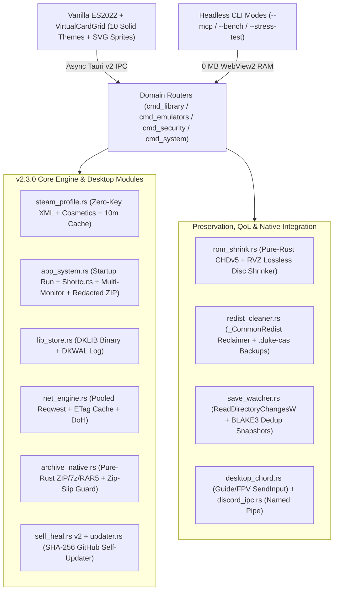

<div align="center">
  
  <h1>Duke Launcher <code>v2.3.0</code></h1>
  <p>
    <strong>All Your Games. Maximum FPS. Zero Bloat.</strong><br />
    One tiny, free Windows 11 game launcher for PC, Steam, Xbox, Epic, GOG, Nintendo &amp; retro classics.
  </p>
  <p>
    <a href="https://github.com/willferrara/duke-systems/releases/latest"></a>
    <a href="https://github.com/willferrara/duke-systems/releases/latest"></a>
    <a href="https://github.com/willferrara/duke-systems/releases/latest"></a>
    <a href="https://github.com/willferrara/duke-systems/releases/latest"></a>
    <a href="#why-gamers-switch"></a>
    <a href="LICENSE"></a>
  </p>
  <p>
    <a href="https://github.com/willferrara/duke-systems/releases/latest">
      
    </a>
  </p>
</div>

---

**Duke Launcher** is a tiny, super-fast, free game launcher that puts all of your **Steam, Xbox, Epic, GOG, and Nintendo/retro games** into one clean app. Most modern launchers keep heavy web browsers running in the background that quietly eat hundreds of megabytes of memory, pester you to log in, track your habits, and still leave you to troubleshoot broken downloads or missing DLLs on your own. **Duke Launcher (`v2.3.0`)** uses under 20 MB idle RAM (or just a few MB if you opt into minimizing to the system tray) so your games get **maximum FPS**, **never forces you to create an account or collects any data**, **shows a live Steam Hover Mini-Profile card right in the titlebar without needing a Steam login**, **scrolls 25,000+ games effortlessly with zero stutter**, **unpacks ZIP/7z/RAR downloads automatically without extra tools**, **shrinks oversized disc images & duplicate redistributables safely**, **protects game saves in real time while you play**, **checks GitHub Releases for SHA-256 verified 1-click updates**, and **heals itself automatically after crashes or `Alt+F4`**.

---

## Why Gamers Switch

| Everyday Question | Duke Launcher (`v2.3.0`) | Steam | Xbox App | Playnite | Hydra |
| :--- | :---: | :---: | :---: | :---: | :---: |
| **Memory Used While You Play** | **&lt;20 MB** (stays out of your way) | ~350–600 MB | ~250–500 MB | ~150–300 MB | ~250–450 MB |
| **Account Login or Tracking?** | **Never — 100% private &amp; local** | Account required | Microsoft account required | Optional | Optional |
| **Every Store &amp; Console in One App?** | **Steam, Xbox, Epic, GOG, Nintendo &amp; Retro** | Steam + manual shortcuts | Xbox + PC Game Pass | Yes (via plugins) | Limited |
| **Live Steam Mini-Profile Card (Zero Login)?** | **Yes — Avatar, Frame, Level, Bio &amp; Top 3 Games** | Requires full client | No | No | No |
| **Sets Up Downloads &amp; Retro Games For You?** | **Built-in ZIP/7z/RAR unpacker + 1-click `.chd`/`.rvz` shrink** | Store games only | Store games only | Manual setup | Partial |
| **Malware &amp; Virus Shield Before Launch?** | **Built-in safety scanner &amp; isolated game jail** | No | No | No | No |
| **Fixes Crashing or Broken Games (`0xC000007B`)?** | **1-click automatic repair + self-healing recovery** | Basic file verify | Basic repair | No | No |
| **Auto-Saves &amp; Duplicate Bloat Cleaner?** | **Real-time save snapshots + `.duke-cas` bloat reclaimer** | Cloud sync only | Cloud sync only | Add-ons needed | No |
| **Controller Desktop Mouse &amp; Discord Status?** | **Hold Guide (`LB+RB` on FPV) + zero-bloat Discord status** | Big Picture Config | No | Partial | No |

---

## Everyday Features Made Simple (`v2.3.0`)

- **Live Steam Hover Mini-Profile Card (Zero Login Required):** Hover over your Steam avatar pill in the top titlebar (or open the **Friends** drawer) to see a sleek Windows 11 mini-profile card showing your avatar, equipped avatar frame, profile background, Steam Level, custom bio, **Top 3 Most-Played Showcase Games**, and a **"What Strangers See"** privacy badge—plus a **Preview ID** bar to preview how any Steam profile looks publicly.
- **Complete Windows 11 Desktop App Experience:** Includes 1-click **Desktop &amp; Start Menu Shortcuts**, system-wide `duke://` links (`duke://open`, `duke://launch/<game_id>`, `duke://deck`), optional **Launch at Windows Startup** (`--tray` silent boot support), a full right-click **System Tray menu**, multi-monitor-safe window position memory, and a 1-click **Redacted Diagnostics Bundle (`.zip`)** exporter for clean bug reports.
- **Instant Scrolling Across 25,000+ Games:** Virtualized library and catalog grids keep only visible cards in memory so browsing huge collections stays locked at 120 FPS with under 20 MB idle RAM.
- **All Your Games in One Clean Screen:** Click **Import Existing Libraries** to pull in Steam, Xbox, Epic, and GOG games automatically, or drag and drop `.exe` files, folders, shortcuts, and ROMs straight onto the window.
- **Zero-Hassle Retro Disc Shrinking (`.chd` / `.rvz`):** Automatically groups multi-disc `.cue`/`.bin` sets, verifies BIOS firmware hashes, patches ROMs safely without altering originals, and shrinks `.bin`/`.cue`/`.iso` or GameCube/Wii discs losslessly in 1 click.
- **Reclaim Gigabytes of Duplicate Installers Safely:** Remove dead `_CommonRedist`, DirectX, `vcredist`, `.NET` installers, and old crash dumps in one click with automatic `.duke-cas` rollback protection.
- **Real-Time Auto Save Snapshots While Playing:** Detects save changes during gameplay and quietly saves instant deduplicated restore points without overwriting good saves.
- **Built-In GitHub Auto-Updater (SHA-256 Verified):** Quietly checks official [GitHub Releases](https://github.com/willferrara/duke-systems/releases/latest) in the background (you can turn this off in **Settings**), previews full release notes including core engine (`duke-core`) updates, picks the right installer or portable `.exe` automatically, verifies the cryptographic SHA-256 file fingerprint before touching anything, and updates cleanly in one click while keeping your games and `data/` folder untouched.
- **Taskbar Minimize &amp; Opt-In System Tray Controls:** Clicking **Minimize** drops Duke Launcher to your Windows taskbar like a normal app by default, and clicking **Close (`×`)** exits cleanly. Want even lower background memory while gaming? Enable **Minimize to System Tray** or **Close Button Minimizes to Tray** in **Settings** anytime.
- **Self-Healing Startup Protection:** If Windows reboots or a download is interrupted mid-flight, Duke Launcher automatically restores backups, cleans temp files, repairs library indexes, and tells you via a brief startup toast.
- **Built-In Discord Status &amp; Controller Desktop Mode:** Shows your currently playing game on Discord with zero extra background apps, and lets you hold **Guide** (or `LB+RB` on FPV radios) to move the mouse, click, scroll, and `Alt+Tab` right from your couch.
- **Take Your Library on a USB Drive:** Drop an empty `portable.txt` file next to `Duke Launcher.exe` to store everything neatly in `./data/` with zero Registry or AppData clutter.

---

> [!NOTE]
> **Active Focus:** **Duke Launcher** (`duke-launcher/`) is the active, recommended flagship application in this repository. Experimental companion folders (`duke-systems/`, `duke-monitor/`, `duke-capture/`, `duke-input/`, `duke-swarm-node/`, and `duke-companion/`) are currently **paused** — please download and use **Duke Launcher** from [Releases](https://github.com/willferrara/duke-systems/releases/latest).

---

<details>
<summary><strong>Under the Hood (For Developers &amp; Systems Engineers)</strong></summary>

### Architecture Overview (`v2.3.0`)

**Duke Launcher** is built in Rust + Win32 FFI + Tauri v2 (`WebView2` UI rendered with Vanilla ES2022 JS and 10 zero-bloat solid CSS themes — zero Electron, zero Chromium bundling, zero runtime `.unwrap()` calls under `panic = "abort"`). All UI-facing Tauri commands offload I/O, FFI, and network work asynchronously via `tokio::task::spawn_blocking` across four domain routers (`cmd_library.rs`, `cmd_emulators.rs`, `cmd_security.rs`, `cmd_system.rs`) while keeping `main.rs` as a crisp bootstrap entrypoint.



### Key `v2.3.0` Engineering Systems

- **Zero-Account Steam Public Profile & Cosmetics Resolver (`steam_profile.rs`):** Auto-detects the local `SteamID64` from `Steam\config\loginusers.vdf` (or accepts any custom `SteamID64` / `steamcommunity.com/id/<vanity>` override), parses public Steam Community XML feeds (`?xml=1`) for persona, status, bio, visibility state, and Top 3 Most-Played Showcase Games, and optionally enriches with Steam Level, animated avatars, avatar frames, and profile backgrounds via DPAPI-protected Web API keys with a 10-minute memory/disk cache.
- **Full Windows 11 Desktop System Layer (`app_system.rs`):** Manages `HKCU\Software\Microsoft\Windows\CurrentVersion\Run\DukeLauncher` (`"<exe>"` or `"<exe>" --tray`), creates Desktop and Start Menu `.lnk` shortcuts + `HKCU\Software\Classes\duke` (`duke://open`, `duke://launch/<id>`, `duke://deck`, `duke://download`), installs the 4-action system tray menu (`Open Duke Launcher`, `Duke Deck Mode`, `Check for Updates`, `Quit Duke Launcher`), validates saved window geometry against connected displays via `MonitorFromPoint` / `GetMonitorInfoW`, and exports privacy-redacted `.zip` diagnostics bundles.
- **Decomposed Async Command Layer (`cmd_library.rs`, `cmd_emulators.rs`, `cmd_security.rs`, `cmd_system.rs`):** Splits 4,800+ lines out of `main.rs`, offloads blocking I/O/Win32/network calls via `run_blocking_timeout` without holding `std::sync::Mutex` across `.await` points, and uses a shared shutdown teardown hook.
- **GitHub Releases Self-Updater (`updater.rs`):** Queries the GitHub Releases API over `net_engine` with DoH/proxy support, parses SemVer tags, detects portable vs. installed deployments and extra release bundle assets, verifies every byte with SHA-256 (`digest: "sha256:<hex>"`), and swaps binaries cleanly via a detached PID-waiting trampoline preserving `data/` and `portable.txt`.
- **Zero-Copy Virtual Viewport Recycler (`virtual_grid.js`):** Keeps live DOM card nodes capped at `~60` across both `My Games` and sparse `25,000+`-title `Search Games` (`query_catalog_mmap`) with responsive zoom (`125px`–`280px`), compact cards, and `Duke Deck` Couch Mode.
- **Binary Library Engine (`lib_store.rs` `DKLIB` + `.dkwal`):** Stores library metadata in compact `postcard` binary records with an append-only CRC-protected WAL for constant-time playtime, favorite, and cover updates instead of rewriting large JSON blobs.
- **Self-Healing Engine v2 (`self_heal.rs`):** Tracks clean exits via `session.lock`, logs stall breadcrumbs via an IPC watchdog, disables repeating stall offenders in `disabled_jobs.json`, auto-restores corrupt `.bak` configs, repairs `library.dklib`/`.dkcat`/`.duke-cas`, clears stale WebView2 locks, and emits startup toast summaries.
- **Pure-Rust Archive, Disc & Bloat Tooling (`archive_native.rs`, `rom_shrink.rs`, `redist_cleaner.rs`):** Extracts `.zip`/`.7z`/`.rar` in-process with canonical path Zip-Slip rejection; losslessly compresses `.bin`/`.cue`/`.iso` -> `.chd` v5 and GameCube/Wii `.iso` -> `.rvz` with SHA-1/hunk verification; reclaims duplicate redistributables safely behind `.duke-cas/` snapshots.
- **Discord IPC, Save Watcher & Controller Chord Layer (`discord_ipc.rs`, `save_watcher.rs`, `desktop_chord.rs`):** Speaks Discord's binary named-pipe IPC (`\\.\pipe\discord-ipc-0..9`), watches save trees via Win32 `ReadDirectoryChangesW` with `BLAKE3` deduplication, and translates Guide/`LB+RB` controller chords into `SendInput` cursor/scroll/hotkey actions.
- **Frontier Security & Streaming Suite:** `AppContainer` + WFP jails (`duke_jail.rs`), PE32+ import X-Ray + `WinVerifyTrust` (`pe_inspect.rs`), DPAPI secrets vault (`privacy_vault.rs`), QUIC `Duke Link` v2 (`duke_link.rs`), `DirectStorage` `BLER` texture conditioning (`direct_storage.rs`), `wasmtime` sandboxed plugins (`wasm_plugins.rs`), and deterministic chaos verification (`stress_harness.rs`).

### Headless CLI Modes (`0 MB` WebView2 RAM)

```powershell
# Self-contained hardware & throughput benchmark
duke-launcher.exe --bench

# Deterministic chaos, fallback recovery & UI/IPC parity test suite
duke-launcher.exe --stress-test

# Headless Model Context Protocol server (JSON-RPC 2.0 over stdin/stdout)
duke-launcher.exe --mcp
```

Example `mcp_config.json` entry:

```json
{
  "mcpServers": {
    "duke-launcher": {
      "command": "C:\\Program Files\\Duke Launcher\\duke-launcher.exe",
      "args": ["--mcp"]
    }
  }
}
```

### Build & Verification From Source (Windows 11 / MSVC)

```powershell
# 1. Workspace hygiene, syntax & DOM/SVG/IPC parity gate
powershell -NoProfile -ExecutionPolicy Bypass -File scripts/verify-hygiene.ps1

# 2. Strict workspace lint & unit/integration test suite
cargo clippy --workspace --all-targets -- -D warnings
cargo test --workspace

# 3. Optimized Windows release build
Set-Location duke-launcher
npm ci
npm run tauri build
```

</details>

---

## License

Released under the [MIT License](LICENSE).
