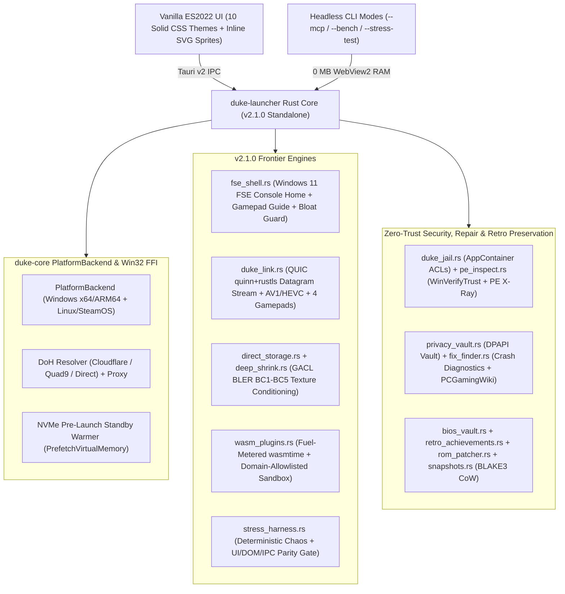

<div align="center">
  
  <h1>Duke Launcher <code>v2.1.0</code></h1>
  <p>
    <strong>All Your Games. Maximum FPS. Zero Bloat.</strong><br />
    One tiny, free Windows 11 game launcher for PC, Steam, Xbox, Epic, GOG, Nintendo &amp; retro classics.
  </p>
  <p>
    <a href="https://github.com/willferrara/duke-systems/releases/latest"></a>
    <a href="https://github.com/willferrara/duke-systems/releases/latest"></a>
    <a href="https://github.com/willferrara/duke-systems/releases/latest"></a>
    <a href="https://github.com/willferrara/duke-systems/releases/latest"></a>
    <a href="#why-gamers-switch"></a>
    <a href="LICENSE"></a>
  </p>
  <p>
    <a href="https://github.com/willferrara/duke-systems/releases/latest">
      
    </a>
  </p>
</div>

---

**Duke Launcher** is a tiny, super-fast, free game launcher that puts all of your **Steam, Xbox, Epic, GOG, and Nintendo/retro games** into one clean app. Most modern launchers keep heavy web browsers running in the background that quietly eat hundreds of megabytes of memory, pester you to log in, track your habits, and still leave you to troubleshoot broken downloads or missing DLLs on your own. **Duke Launcher (`v2.1.0`)** uses almost zero memory (~20 MB idle, or just a few MB in the system tray) so your games get **maximum FPS**, **never forces you to create an account or collects any data**, **downloads, unpacks, and sets up games automatically**, **scans and blocks viruses or malware before you launch anything**, and **fixes broken or crashing games in one click**.

---

## Why Gamers Switch

| Everyday Question | Duke Launcher (`v2.1.0`) | Steam | Xbox App | Playnite | Hydra |
| :--- | :---: | :---: | :---: | :---: | :---: |
| **Memory Used While You Play** | **~20 MB** (stays out of your way) | ~350–600 MB | ~250–500 MB | ~150–300 MB | ~250–450 MB |
| **Account Login or Tracking?** | **Never — 100% private &amp; local** | Account required | Microsoft account required | Optional | Optional |
| **Every Store &amp; Console in One App?** | **Steam, Xbox, Epic, GOG, Nintendo &amp; Retro** | Steam + manual shortcuts | Xbox + PC Game Pass | Yes (via plugins) | Limited |
| **Sets Up Downloads &amp; Retro Games For You?** | **Auto-downloads, extracts, groups discs &amp; configures** | Store games only | Store games only | Manual setup | Partial |
| **Malware &amp; Virus Shield Before Launch?** | **Built-in safety scanner &amp; isolated game jail** | No | No | No | No |
| **Fixes Crashing or Broken Games (`0xC000007B`)?** | **1-click automatic repair + missing DLL installer** | Basic file verify | Basic repair | No | No |
| **Play Couch Co-Op With Friends Online (Zero Port Forwarding)?** | **Built-in 4-player Duke Link v2 streaming** | Remote Play (account required) | No | No | No |
| **Turn Any Windows 11 PC / Handheld Into a Console?** | **1-click Windows Gaming Home (`FSE`) console mode** | Big Picture Mode | Compact Mode | Fullscreen Mode | No |

---

## Everyday Features Made Simple

- **All Your Games in One Clean Screen:** Click **Import Existing Libraries** to pull in Steam, Xbox, Epic, and GOG games automatically, or drag and drop `.exe` files, folders, shortcuts, and ROMs straight onto the window.
- **Zero-Hassle Retro &amp; Nintendo Gaming:** Automatically groups multi-disc games (`Disc 1`, `Disc 2`), checks BIOS/firmware hashes so emulators work on the first try, applies ROM patches safely without ruining your originals, and supports RetroAchievements.
- **1-Click Crash &amp; Missing DLL Fixer:** If a game closes in under 5 seconds or throws confusing errors like `0xC000007B`, Duke Launcher tells you why in plain English and repairs missing runtime DLLs or compatibility settings in one click.
- **Game-Save Time Machine:** Back up and roll back your game files and saves anytime without wasting drive space.
- **Shrink Huge Games Without Losing Quality:** Automatically compresses older games and textures so you can fit far more games on your SSD.
- **Safe By Default:** Scans downloaded `.exe` and `.dll` mod files before launching, optionally runs untrusted games inside an isolated Windows sandbox, and keeps your API keys encrypted locally on your PC.
- **Take Your Library on a USB Drive:** Drop an empty `portable.txt` file next to `Duke Launcher.exe` to store everything neatly in `./data/` with zero Registry or AppData clutter.

---

> [!NOTE]
> **Active Focus:** **Duke Launcher** (`duke-launcher/`) is the active, recommended flagship application in this repository. Experimental companion folders (`duke-systems/`, `duke-monitor/`, `duke-capture/`, `duke-input/`, `duke-swarm-node/`, and `duke-companion/`) are currently **paused** — please download and use **Duke Launcher** from [Releases](https://github.com/willferrara/duke-systems/releases/latest).

---

<details>
<summary><strong>Under the Hood (For Developers &amp; Systems Engineers)</strong></summary>

### Architecture Overview (`v2.1.0`)

**Duke Launcher** is built in Rust + Win32 FFI + Tauri v2 (`WebView2` UI rendered with Vanilla ES2022 JS and 10 zero-bloat CSS themes — zero Electron, zero Chromium bundling, zero runtime `.unwrap()` calls under `panic = "abort"`). It uses the workspace `duke-core` library with a cross-platform `PlatformBackend` abstraction supporting Windows `x86_64` / `aarch64` (ARM64) and feature-gated Linux / SteamOS targets.



### Key `v2.1.0` Engineering Systems

- **Instant `<100 ms` Boot & Universal Gamepad / FPV Controller Support (`couch_mode.rs`, `catalog_mmap.rs`, `duke-input`):** Returns cached library and zero-copy `memmap2` catalog results immediately while enriching artwork and external playtimes asynchronously; Duke Deck enumerates XInput, PlayStation DualSense/DS4, Switch Pro/8BitDo, Generic USB HID, and **RadioMaster Pocket / EdgeTX FPV joysticks (`VID_1209&PID_4F54`)** cleanly via safe dynamic `OnceLock` loaders + W3C Gamepad API fallback and live axis calibration.
- **Zero-Login Multi-Launcher Playtime Sync (`playtime_sync.rs`, `importers.rs`):** Non-destructively merges external hours from Steam (`localconfig.vdf`), Xbox / PC Game Pass (`Microsoft.GamingApp_*` + `GameConfigStore`), Epic Games, GOG Galaxy (`galaxy-2.0.db` `GameTimes`), Ubisoft Connect, EA App, and RetroArch (`.lpl` / `.lrtl`) on startup and game exit (`max(imported, external) + duke_secs`).
- **6-Stage Cascading Cover Finder & Interactive Web Search Picker (`artwork.rs`):** Cleans release/version/region tags (`clean_cover_query`), matches Steam Store titles via Jaro-Winkler `>= 0.78`, queries Libretro Boxarts across all 24 consoles, checks SteamGridDB, runs DoH Web Image Search (`>= 200x200`, `0.55..=1.15` aspect ratio), and provides a 1-click **"Pick Custom Cover / Search Web Cover"** picker on the Single-Game Detail View.

- **Cross-Platform `PlatformBackend` (`duke-core/src/platform_backend.rs`):** Unifies OS sandbox isolation and frame-time telemetry across Windows `x86_64` / `aarch64-pc-windows-msvc` (`AppContainer`, `ETW`, `UserGpuPreferences`) and `x86_64-unknown-linux-gnu` (`Landlock` + `seccomp` + `bwrap` namespace stubs & `DRM`/`Gamescope` telemetry).
- **Windows 11 Full Screen Experience (`fse_shell.rs`):** Registers `Duke Launcher.exe --couch` alongside Windows 11's `FSE` gaming shell, binds Xbox/PlayStation Guide triggers (`Win+G` / `VK_GAMEPAD_VIEW`), and trims/suspends non-essential background bloat while protecting critical Windows system processes via `is_safe_to_suspend_bloat_exe`.
- **`Duke Link` v2 (`duke_link.rs`):** Replaces raw UDP with **QUIC (`quinn` + `rustls` with ephemeral self-signed certs)** unreliable datagrams, drops stale frames immediately on loss, probes hardware **AV1 / HEVC** encoders, adapts bitrate on a `50 ms` loop over Tailscale/LAN, and multiplexes up to **4 concurrent virtual XInput/DualSense gamepads**.
- **DirectStorage 1.4 `GACL` / `BLER` `BC1`–`BC5` (`direct_storage.rs` & `deep_shrink.rs`):** Applies bijective block-level entropy reduction (`BLER` `DKDS_VERSION_V2`) to `.dds` `BC1`–`BC5` color/alpha/normal planes before Zstd streaming, yielding bit-exact GPU decompression and extra storage shrinkage.
- **Capability-Gated `wasmtime` Plugin Sandbox (`wasm_plugins.rs`):** Runs community `.wasm` plugins inside a strict fuel-metered (`consume_fuel`) and memory-capped (`StoreLimitsBuilder`) sandbox with zero filesystem/WASI/credential access and HTTPS-only domain allowlisting (redirects disabled).
- **Deterministic Chaos & Parity Stress Harness (`stress_harness.rs` + `--stress-test`):** Exercises corrupt `.zip` archives, multi-disc `.cue`/`.bin` `.m3u` sets, wrong-hash/missing BIOS dumps, disabled `Client-ProjFS`, malformed `library.json`/`settings.json`/Hydra/`.dkcat` recovery, `0xC000007B` crash repair, `BC1` BLER corruption detection, `wasmtime` HTTP exfil denial, and 100% DOM ID / SVG sprite / 10-theme / Tauri IPC parity.
- **Security, Snapshots & Preservation:** `AppContainer` + WFP offline jails (`duke_jail.rs`), PE32/PE32+ import X-Ray + `WinVerifyTrust` (`pe_inspect.rs`), DPAPI secrets vault (`privacy_vault.rs`), `BLAKE3` + `CreateHardLinkW` CoW snapshots (`snapshots.rs`), `memmap2` trigram catalog (`catalog_mmap.rs`), `ETW` zero-injection frame-time telemetry (`etw_xray.rs`), and `portable.txt` portable storage (`./data/`).

### Headless CLI Modes (`0 MB` WebView2 RAM)

```powershell
# Self-contained hardware & throughput benchmark
duke-launcher.exe --bench

# Deterministic chaos, fallback recovery & UI/IPC parity test suite
duke-launcher.exe --stress-test

# Headless Model Context Protocol server (JSON-RPC 2.0 over stdin/stdout)
duke-launcher.exe --mcp
```

Example `mcp_config.json` entry:

```json
{
  "mcpServers": {
    "duke-launcher": {
      "command": "C:\\Program Files\\Duke Launcher\\duke-launcher.exe",
      "args": ["--mcp"]
    }
  }
}
```

### Build & Verification From Source (Windows 11 / MSVC)

```powershell
# 1. Frontend syntax check
node --check duke-launcher/src/api.js
node --check duke-launcher/src/main.js

# 2. Strict workspace lint & unit/integration test suite
cargo clippy --workspace --all-targets -- -D warnings
cargo test --workspace

# 3. Optimized Windows release build
Set-Location duke-launcher
npm ci
npm run tauri build
```

</details>

---

## License

Released under the [MIT License](LICENSE).
