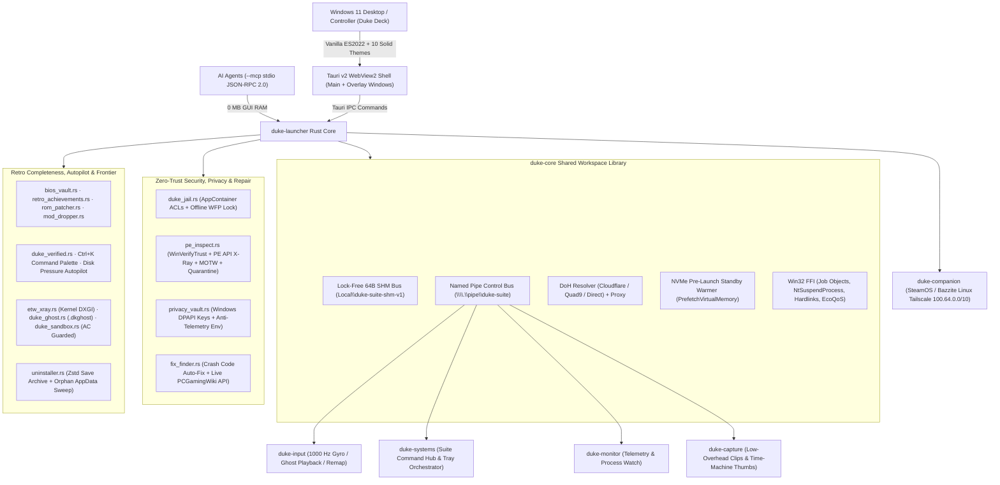

<div align="center">
  
  <h1>The Duke Suite &amp; Duke Launcher <code>v1.0.0</code></h1>
  <p>
    <strong>Zero-Telemetry Windows 11 Native Game Hub, Security Shield &amp; Retro Cockpit</strong><br />
    Engineered in pure Rust + Win32 FFI + Tauri v2 (Zero Electron / Chromium runtime).
  </p>
  <p>
    <a href=".github/workflows/ci.yml"></a>
    <a href=".github/workflows/ci.yml"></a>
    <a href=".github/workflows/release.yml"></a>
    <a href="#zero-account-privacy-security"></a>
    <a href="LICENSE"></a>
  </p>
</div>

---

## Why Duke Launcher `v1.0.0`?

**Duke Launcher** is the flagship desktop application of **The Duke Suite** (`duke-core`, `duke-launcher`, `duke-systems`, `duke-input`, `duke-monitor`, `duke-capture`, and `duke-companion`). Designed as a strictly local, zero-account replacement for bloated Chromium launchers, it pairs native Windows 11 APIs (`AppContainer`, `WinVerifyTrust`, `DPAPI`, `ETW`, `CreateHardLinkW`, `PrefetchVirtualMemory`, `NtSuspendProcess`, `NtSetTimerResolution`) with 10 opaque zero-bloat CSS themes.

| Capability | Duke Launcher `v1.0.0` | Steam | Playnite | Hydra Launcher | Heroic |
| :--- | :---: | :---: | :---: | :---: | :---: |
| **Runtime Architecture** | **Rust + Win32 FFI + WebView2** | CEF (Chromium) | .NET / WPF | Electron + Chromium | Electron + Chromium |
| **Idle Working-Set Target** | **&lt; 25 MB** (&lt;8 MB in Tray) | ~350–600 MB | ~150–300 MB | ~250–450 MB | ~250–450 MB |
| **Account Login Required** | **Never (100% Local + DPAPI)** | Required | Optional | Optional | Store Login |
| **OS AppContainer Game Jail &amp; Offline Lock** | **Built-In Per-Game ACL + WFP** | No | No | No | No |
| **PE32/PE32+ Malware X-Ray &amp; Authenticode** | **Built-In (`WinVerifyTrust` + Entropy)** | No | No | No | No |
| **Crash-to-Fix Engine + PCGamingWiki API** | **Auto Exit-Code Repair + Live Links** | No | Extension | No | No |
| **Zero-Injection Frame-Time X-Ray (`ETW`)** | **Kernel DXGI / DxgKrnl (AC-Safe)** | Overlay Injection | No | No | MangoHud |
| **BIOS Validator, RetroAchievements &amp; ROM Patcher** | **MD5/SHA-1 + `rc_hash` + IPS/BPS/UPS/XDelta** | No | Plugins | No | No |
| **CoW Snapshots &amp; `WOF` Disk Autopilot** | **BLAKE3 + Hardlinks + LZX Shrink** | No | No | No | No |
| **100% Portable USB Mode** | **Drop `portable.txt` Beside `.exe`** | Partial | Yes | Partial | AppImage / Zip |

---

## System Architecture



---

## Quick Start

1. **Install or Extract:** Run the Duke Launcher NSIS/MSI installer, or extract the ZIP archive anywhere for portable execution.
2. **Import Libraries Automatically:** Click **Import Existing Libraries** to scan Steam (VDF/ACF), Epic (`.item`), GOG (Registry), Xbox (`XboxGames`), or drop `.exe` files, folders, shortcuts, and ROMs directly onto the window.
3. **Use Clean 1-Screen Cards:** Every game exposes **Play**, **Fix Game**, **Save Backup**, and **Settings** without cluttered menus.
4. **Press `Ctrl+K` Anytime:** Open the unified **Everything Command Palette** to search installed games, the offline `.dkcat` catalog, online friends, settings toggles, save restore points, and 1-click security/fix actions.

---

## Zero-Account Privacy & Security

- **OS-Enforced AppContainer Game Jail (`duke_jail.rs`):** Confines untrusted or DRM-free titles via `userenv.dll` AppContainer tokens (`PROC_THREAD_ATTRIBUTE_SECURITY_CAPABILITIES`) restricting file writes strictly to the game directory and `.duke-profile/`, with a **1-Click Offline Mode Network Lock** omitting `internetClient` and adding a per-executable Windows Filtering Platform (`WFP`) outbound block rule.
- **Pre-Launch Malware X-Ray (`pe_inspect.rs`):** Analyzes PE32/PE32+ import tables for high-risk APIs (`VirtualAllocEx` + `WriteProcessMemory` + `CreateRemoteThread`, DPAPI/LSASS access, hidden PowerShell droppers, Run-key persistence), checks `WinVerifyTrust` Authenticode signatures, strips `:Zone.Identifier` safely on verified files, supports optional SHA-256 hash lookups, and quarantines suspicious payloads.
- **Windows DPAPI Privacy Vault (`privacy_vault.rs`):** Encrypts optional Steam, Xbox (`xbl.io`), RetroAchievements, and SteamGridDB API keys under local user credentials (`CryptProtectData`), strips analytics env vars (`DO_NOT_TRACK=1`, `SENTRY_DSN=`, `UNITY_DISABLE_ANALYTICS=1`, `UE_DISABLE_CRASH_REPORTER=1`), and supports encrypted DoH + 1-click Tor / SOCKS5 / WireGuard proxy presets.
- **Automatic Crash-to-Fix Engine (`fix_finder.rs`):** Detects `&lt;5s` premature exits and common Windows error codes (`0xC000007B`, `0xC0000005`, `0xC0000135`, `0x8007007E`), applies reversible fixes backed by `.duke-cas/` snapshots (missing DirectX/VC++ DLLs, 4 GB LAA patch, DXVK toggle, High-DPI/compatibility shims), and fetches live **PCGamingWiki** workaround/ultrawide/controller intelligence alongside **ProtonDB**, **Steam Discussions**, and **GitHub Issues** links.

---

## Retro & PC Completeness

- **1-Click BIOS & Firmware Vault (`bios_vault.rs`):** Scans archives (`.zip`/`.7z`) and folders, verifies exact MD5/SHA-1 checksums against Libretro `.info` manifests, routes valid BIOS images into DuckStation, PCSX2, melonDS, Azahar, and RetroArch `system/` paths, backs up verified dumps into `.duke-cas/`, and quarantines bad dumps.
- **Native RetroAchievements (`retro_achievements.rs`):** Implements `rc_hash`-compatible hashing (stripping 16-byte iNES headers on NES, hashing internal executables on PS1/PS2/PSP/GameCube) with DPAPI-encrypted read-only API keys, Hardcore badges, and Windows 11 unlock notifications.
- **Multi-Disc `.m3u` Grouping & Pure-Rust ROM Patcher (`rom_patcher.rs`):** Automatically groups `(Disc 1)`, `(Disc 2)` images into unified cards with generated `.m3u` playlists and applies `.ips`, `.bps`, `.ups`, and `.xdelta` patches natively in pure Rust with source CRC32/SHA-1 verification and non-destructive patched launch profiles.
- **Clean Game Uninstaller (`uninstaller.rs`):** Optionally archives saves into `&lt;5 MB` Zstd bundles before removing the game folder, `.duke-profile/`, orphaned `%LOCALAPPDATA%` / `Documents\My Games` directories, dead Uninstall registry entries, firewall rules, and unreferenced `.duke-cas/` blobs.
- **Workshop & Mod Archive Dropper (`mod_dropper.rs`):** Accepts Steam Workshop URLs or dragged Nexus `.zip`/`.7z` archives, scanning every dropped `.dll` and `.asi` with `pe_inspect.rs` heuristics before mod-graph staging.

---

## Invisible Autopilot & Frontier Engines

- **"Duke Verified" Compatibility Matrix (`duke_verified.rs`):** Keyed anonymously by binary BLAKE3 hash (hardware/OS identifiers stripped before export), auto-applying proven DXVK / 4 GB LAA / emulator core flags and mapping crashes to PCGamingWiki workarounds.
- **Disk-Space Pressure Autopilot (`deep_shrink.rs` + `ntfs_compress.rs`):** Watches free space on your primary library drive against a configurable threshold (default `50 GB`), ranking untouched `60+` day games by reclaimable `WOF/LZX` compression + foreign language pack savings before user-confirmed compression and `.duke-cas/` cleanup.
- **Zero-Injection ETW Performance Scorecard (`etw_xray.rs`):** Consumes `Microsoft-Windows-DXGI` &amp; `DxgKrnl` ETW events without injecting DLLs, computing `1%` / `0.1%` frame-time lows, CPU vs. GPU bottleneck percentages, shader-stutter counts, background-process spike correlations, GPU TDR resets, and actionable 1-click optimizations.
- **Deterministic Input Ghost (`duke_ghost.rs` + `duke-input`):** Compresses 60 Hz delta controller streams into `~10 KB/min` Zstd `.dkghost` files synced with `Duke Time-Machine` checkpoints and automatically pauses playback if the game loses focus.
- **Single-Player Overlay Trainer (`duke_sandbox.rs`):** Provides live value scanning/editing and `NtSetTimerResolution` speedhack pacing in the Guide overlay, immediately disarming whenever `EasyAntiCheat`, `BattlEye`, `Riot Vanguard`, or `FACEIT` is detected.
- **Headless Linux / Steam Deck Companion (`duke-companion`):** Lightweight pure-Rust daemon for SteamOS and Bazzite nodes over Tailscale (`100.64.0.0/10`), streaming `64 KiB` heap-buffered BLAKE3 chunks and mapping `.duke-profile/` saves bidirectionally to Proton `compatdata/&lt;app_id&gt;/pfx/`.

---

## 100% Portable USB Mode (`portable.txt`)

Drop an empty **`portable.txt`** file (or `portable.flag`, or create a `./data/` folder) next to `Duke Launcher.exe`:
- Zero files are written to host `%LOCALAPPDATA%`, AppData, or user Registry paths.
- **`library.json`**, **`settings.json`**, **`catalog.dkcat`**, **`.duke-cas/`**, **`ghosts/`**, and **`emulators/`** resolve relative to the executable (`./data/`).

---

## Headless CLI Modes (`--bench` &amp; `--mcp`)

```powershell
# Self-contained hardware & throughput benchmark (0 MB WebView2 RAM)
duke-launcher.exe --bench

# Headless Model Context Protocol (JSON-RPC 2.0 over stdio)
duke-launcher.exe --mcp
```

Example MCP client entry:

```json
{
  "mcpServers": {
    "duke-launcher": {
      "command": "C:\\Program Files\\Duke Launcher\\duke-launcher.exe",
      "args": ["--mcp"]
    }
  }
}
```

---

## Build &amp; Verification From Source (Windows 11 / MSVC)

```powershell
# 1. Frontend syntax verification
node --check duke-launcher/src/api.js
node --check duke-launcher/src/main.js

# 2. Workspace strict lint & unit tests
cargo clippy --workspace --all-targets -- -D warnings
cargo test --workspace

# 3. Optimized Windows x64 release build
Set-Location duke-launcher
npm ci
npm run tauri build
```

---

## License

Released under the [MIT License](LICENSE).
