# The Duke Suite & Duke Launcher

[](../../actions/workflows/ci.yml)
[](.github/workflows/release.yml)
[](LICENSE)

**Duke Systems** is an ultra-lightweight, zero-telemetry Windows 11 system toolkit (`duke-core`, `duke-launcher`, `duke-systems`, `duke-monitor`, `duke-capture`, `duke-input`) engineered in Rust + Win32 FFI.

Its flagship game library manager, **Duke Launcher**, pairs a native **Tauri v2 + Win32 FFI** backend (`opt-level = 3`, fat LTO, `strip = true`) with a **lock-free shared memory bus (`Local\duke-suite-shm-v1`)**, **NVMe `PrefetchVirtualMemory` asset warmer**, **BLAKE3 + `CreateHardLinkW` copy-on-write snapshots**, **zero-copy `memmap2` binary catalog (`.dkcat`)**, **AIMD in-flight `.tar.zst` / parallel-range `.zip` streaming extractor**, **FastCDC v2020 + `zstd` block delta patcher**, **Duke Swarm LAN/Tailscale game-beam & vector-clock save sync**, **`.duke-profile` portable sandboxing + pure-Rust PE32/PE32+ import auto-healer**, **zero-RAM tray daemon mode** (`<8 MB` baseline background footprint), and a **headless `--mcp` JSON-RPC 2.0 server**.

---

## Architecture Comparison: Native Rust + WebView2 vs. Electron Launchers

| Capability / Footprint | Duke Launcher (`duke-launcher`) | Typical Electron / CEF Game Launchers |
| :--- | :---: | :---: |
| **Executable & Alloc Architecture** | **Pure Rust + Win32 FFI** (`lto = "fat"`, `panic = "abort"`, baseline `~8.7 MB`) | 180 – 450+ MB bundled Chromium |
| **Idle Working-Set RAM** | **~15 – 25 MB** baseline (Win32 `K32EmptyWorkingSet`) | 350 – 900+ MB RAM |
| **Tray Daemon Background RAM** | **<8 MB pure-Rust** (WebView2 renderer destroyed) | 300 – 800+ MB RAM |
| **Cross-App Event IPC** | **~40 ns Lock-Free 64-byte SHM Ring Buffer** (`Local\duke-suite-shm-v1`) + Named Pipe control | JSON IPC over Node/WebSockets |
| **Catalog Startup Parsing** | **`0 ms` Zero-Copy `mmap` (`catalog.dkcat`)** with packed trigram index | Multi-megabyte `JSON.parse()` heap spike |
| **Game-Active Runtime Scheduling** | **Job Object tree** (`ABOVE_NORMAL`) + NVMe Standby RAM pre-warm + Launcher pinned to **EcoQoS** | Unmanaged background Chromium threads |
| **Headless AI Agent CLI Mode** | **0 MB GUI RAM** (`duke-launcher.exe --mcp` stdio JSON-RPC 2.0) | Not supported |
| **Background Gamepad Polling** | **0% CPU** when minimized or unfocused (`visibilityState`) | Continuous polling loop |

---

## System Architecture (`duke-core` & `duke-launcher`)

```mermaid
flowchart TB
    AI["AI Agents (Antigravity CLI / Claude Code / Cursor)"] -->|"JSON-RPC 2.0 over stdio (--mcp)"| MCP["duke-launcher.exe --mcp (0 MB GUI RAM)"]
    User["Windows 11 Desktop / Gamepad / Browser (duke://)"] -->|"Vanilla ES2022 + 10 CSS Themes"| UI["Tauri v2 WebView2 UI (Destroyed to <8 MB in Tray)"]
    UI -->|"Tauri IPC Commands"| App["duke-launcher Rust Engine"]
    MCP -->|"Shared Standalone Cores"| App

    subgraph Core["duke-core Shared Runtime"]
        SHM["Lock-Free 64B SHM Ring Buffer (Local\\duke-suite-shm-v1)"]
        Pipe["Leader-Elected Named Pipe Control Bus (\\\\.\\pipe\\duke-suite)"]
        DoH["DoH DNS Racing Resolver (Cloudflare / Quad9 / Google)"]
        NVMe["NVMe Pre-Launch Standby Warmer (PrefetchVirtualMemory <= 25% Free RAM)"]
        FFI["Win32 FFI (ProcessTreeJob, NtSuspendProcess, CreateHardLinkW, EcoQoS, XInput)"]
        Tray["Zero-RAM Tray Daemon Lifecycle"]
    end

    App --> SHM
    App --> Pipe
    App --> DoH
    App --> NVMe
    App --> FFI
    App --> Tray

    subgraph StorageNet["Zero-Copy Storage, Delta & Swarm Engines"]
        DkCat["catalog.dkcat Mmap + Trigram Inverted Index (memmap2)"]
        CAS["Copy-on-Write Snapshots (.duke-cas + blake3 + CreateHardLinkW)"]
        AIMD["8-Worker AIMD Downloader + In-Flight .tar.zst Ring / Zip EOCD Range Extract"]
        Delta["FastCDC v2020 (16-64 KiB) + Zstd Block Delta Patcher (.dkmanifest)"]
        Swarm["Duke Swarm (UDP 239.255.77.88:47880 + TCP 47881 Game-Beam & Vector Clock Save Sync)"]
        PE["PE32/PE32+ Import Table Auto-Healer + .duke-profile Sandbox"]
    end

    App --> DkCat
    App --> CAS
    App --> AIMD
    App --> Delta
    App --> Swarm
    App --> PE
    App --> Discovery["DMCA-Safe Directory (search_sites.json) + Hydra Manifests (sources.json)"]
    App --> Ludusavi["Ludusavi Save Discovery + Rolling 5 Pure-Rust ZIP Backups"]
    App --> Importers["1-Click Importer (Steam VDF/ACF, Epic .item, GOG Registry, Xbox .GamingRoot)"]
    App --> Artwork["Steam CDN + SteamGridDB v2 (600x900, Hero, .ICO) & Desktop Shortcuts"]
```



---

## Key Capabilities & Frontier Windows 11 Engines

1. **Lock-Free Shared Memory Ring Buffer (`duke-core/src/shm_bus.rs`)**: Cache-line-aligned (`#[repr(C, align(64))]`) 64-byte event frames (`ShmEventFrame`) over `CreateFileMappingW` + `MapViewOfFile` (`Local\duke-suite-shm-v1`) using `Acquire`/`Release` `AtomicU64` sequence cursors for zero-allocation cross-app notifications (`GameLaunched`, `GameExited`, `GameSuspended`, `RamPurge`, `TelemetryTick`), paired with `\\.\pipe\duke-suite` for variable-length control messages.
2. **Windows 11 NVMe Pre-Launch Cache Warmer (`duke-core/src/nvme_prefetch.rs`)**: On Play, scans the game directory for largest archives (`.pak`, `.vpk`, `.bsa`, `.ba2`, `.forge`, `.rpf`, `.bin`, `.dat` > 32 MiB) capped at `<= 25%` of free physical RAM via `GlobalMemoryStatusEx`, maps read-only views, and calls `PrefetchVirtualMemory` + parallel overlapped read-ahead to warm Windows Standby RAM without paging pressure. Toggleable globally and per-game.
3. **Instant Copy-on-Write Snapshots (`snapshots.rs`)**: Maintains a same-volume `.duke-cas/` content-addressed store hashed in parallel with `blake3` (64 KB buffers), deduplicating unchanged large files via Win32 `CreateHardLinkW` (cross-drive copy fallback) with millisecond creation/rollback and orphan blob garbage collection.
4. **Zero-Copy Memory-Mapped Binary Catalog (`catalog_mmap.rs`)**: Maps `catalog.dkcat` directly into virtual address space via `memmap2::Mmap` on startup (`DkCatHeader`, packed `#[repr(C)]` `CatalogRecord` structs, UTF-8 string pool, and trigram inverted index), atomically rebuilt on SteamSpy/Steam refresh.
5. **Stream-While-Downloading In-Flight Extractor (`stream_extract.rs` & `main.rs`)**: Upgrades the 8-worker AIMD (`4–64 MiB`) downloader to pipe `.zst`/`.tar.zst` streams through a bounded `sync_channel` ring directly into a background `zstd` + pure-Rust USTAR/PAX extractor *in flight* (eliminating double SSD write amplification), and pre-fetches `.zip` tail EOCD/Zip64 headers via HTTP `Range` requests for parallel entry decompression.
6. **FastCDC v2020 + Zstd Block Delta Patcher (`delta_patch.rs`)**: Builds compact zstd-compressed `.dkmanifest` files (`fastcdc::v2020::StreamCDC` 16–64 KiB chunks + BLAKE3 digests), diffs local directories against target manifests, and stitches unchanged blocks from local disk while transferring only modified chunks.
7. **Duke Swarm LAN/Tailscale Game-Beam & Mesh Save Sync (`swarm.rs`)**: Discovers peers over UDP multicast (`239.255.77.88:47880`) or direct Tailscale host:port entries (`47881`), beams game directories over TCP via FastCDC + BLAKE3 chunk streaming, and reconciles saves on `GameStopped` using vector clocks (`{ node_id: counter }`) with automatic Ludusavi conflict backups.
8. **Portable Sandbox & Pre-Flight PE32/PE32+ DLL Auto-Healer (`pe_inspect.rs`)**: Per-game `.duke-profile` toggle isolates `APPDATA`, `LOCALAPPDATA`, and `USERPROFILE` inside the game folder; pure-Rust PE32/PE32+ import directory parser (`<2 ms`) checks imported DLLs against game dir + `System32` / `SysWOW64` before launch and copies architecture-verified local redistributables (`VCRUNTIME140_1.dll`, `MSVCP140.dll`, `d3dx9_43.dll`, `XInput1_3.dll`) on demand.
9. **Win32 Job Object Process Trees, EcoQoS & Zero-RAM Tray Daemon**: Binds child trees to `ProcessTreeJob` (`ABOVE_NORMAL_PRIORITY_CLASS`), freezes/resumes via `NtSuspendProcess`, pins UI to EcoQoS + `K32EmptyWorkingSet`, and destroys WebView2 in tray mode (`<8 MB` baseline daemon RAM).
10. **DMCA-Safe Directories, Multi-Store Import & `--mcp` AI Control**: Ships with zero hardcoded piracy links (`GOG.com`, `Itch.io`, `Internet Archive`, `My Abandonware`, `PCGamingWiki`, `SteamDB`), `.gitignore`d user `search_sites.json` / Hydra `sources.json`, Steam/Epic/GOG/Xbox importers, SteamGridDB v2 + `60 Hz` XInput Couch Mode, and headless `--mcp` stdio JSON-RPC 2.0.

---

## Configuration & Data Files (`%LOCALAPPDATA%` or Portable `./data`)

Duke Launcher stores runtime state cleanly under `%LOCALAPPDATA%\com.dukelauncher.desktop\`, or automatically enters **Portable Mode** if `portable.flag` or a `./data` folder exists alongside `duke-launcher.exe`:

| File | Purpose & Schema |
| :--- | :--- |
| `library.json` | Installed & imported `GameEntry` records (`id`, `title`, `exePath`, `installDir`, `steamAppId`, `playtimeSeconds`, `launchArgs`, `sandboxEnabled`, `nvmePrefetchEnabled`). |
| `downloads.json` | Resumable `DownloadJob` state including AIMD `SegmentChunk` offsets. |
| `search_sites.json` | *(Gitignored)* User-customized directory search templates containing `{query}` placeholders (initialized with the 6 preservation/official defaults). |
| `sources.json` | *(Gitignored)* Optional user-imported Hydra manifests (`{ "name": "...", "downloads": [{ "title": "...", "uris": ["https://..."], "uploadDate": "...", "fileSize": "..." }] }`). |
| `ludusavi_cache.json` | *(Gitignored)* Normalized Ludusavi save-path database synced over DoH (7-day TTL). |
| `catalog.dkcat` | *(Gitignored)* Memory-mapped binary game catalog (`DKCAT001` header + packed `CatalogRecord` table + trigram index) alongside `catalog_cache.json`. |
| `settings.json` | *(Gitignored)* User preferences (`autoCleanCompleted`, `steamgriddbApiKey`, `suspendHotkey`, `couchMode`, `autoDetectClipboard`, `nvmePrefetchEnabled`, `swarmEnabled`, `swarmNodeName`, `swarmPeers`). |
| `.duke-cas/` / `.duke-profile/` | *(Gitignored)* Per-game BLAKE3 + `CreateHardLinkW` snapshot store & portable `AppData`/`Documents` sandbox directories. |

---

## Headless CLI Modes (`--bench` & `--mcp`)

### Built-In Hardware Benchmark (`duke-launcher.exe --bench`)

Bypass WebView2 initialization (`0 MB` GUI RAM) and execute a self-contained `<2s` hardware benchmark printing a Markdown summary table to `stdout`:

```powershell
duke-launcher.exe --bench
```

Measured subsystems:
- **`duke-shm` Lock-Free Ring Buffer**: Throughput (`ops/sec`) and average latency (`ns/op`) across `100,000` atomic `Local\duke-suite-shm-v1` ring frames
- **`.dkcat` Zero-Copy `memmap2` Catalog**: `30,000`-record memory-map mount latency (`µs`) and trigram + bitflag query latency (`µs`)
- **`BLAKE3` Streaming Hasher**: Sustained 64 KiB streaming throughput (`GB/s`)
- **`FastCDC v2020` Gear-Hash Chunker**: Variable 16–64 KiB content-defined chunking throughput (`MB/s`)

### Headless AI Agent MCP Server (`duke-launcher.exe --mcp`)

Check the `mcp_config.json` entry below to connect Antigravity CLI, Claude Code, or Cursor with **0 MB WebView2 RAM**:

```json
{
  "mcpServers": {
    "duke-launcher": {
      "command": "C:\\Program Files\\Duke Launcher\\duke-launcher.exe",
      "args": ["--mcp"]
    }
  }
}
```

**8 Exposed MCP Tools (`tools/list` / `tools/call`):**
`list_installed_games` · `search_catalog` · `launch_game` · `scan_binary` · `discover_saves` · `backup_saves` · `import_libraries` · `suspend_or_resume_game`

---

## Build & Verification From Source (Windows 11 / MSVC)

```powershell
# 1. Validate frontend ES2022 syntax
node --check duke-launcher/src/api.js
node --check duke-launcher/src/main.js

# 2. Check, lint, and test duke-core (including Win32 Job Object & pipe IPC tests)
cargo check --manifest-path duke-core/Cargo.toml --all-features
cargo clippy --manifest-path duke-core/Cargo.toml --all-features -- -D warnings
cargo test --manifest-path duke-core/Cargo.toml --all-features

# 3. Check, lint, test & benchmark duke-launcher (including AIMD, Shannon entropy/PE, --mcp, & --bench tests)
cargo check --manifest-path duke-launcher/src-tauri/Cargo.toml --tests
cargo clippy --manifest-path duke-launcher/src-tauri/Cargo.toml --all-targets -- -D warnings
cargo test --manifest-path duke-launcher/src-tauri/Cargo.toml
cargo run --release --manifest-path duke-launcher/src-tauri/Cargo.toml -- --bench

# 4. Supply-chain, license & zero-bloat audit
cargo deny --manifest-path duke-launcher/src-tauri/Cargo.toml check licenses bans sources

# 5. Build optimized Windows x64 release executable & NSIS installer
Set-Location duke-launcher
npm ci
npm run tauri build
```

---

## License

Released under the [MIT License](LICENSE).
